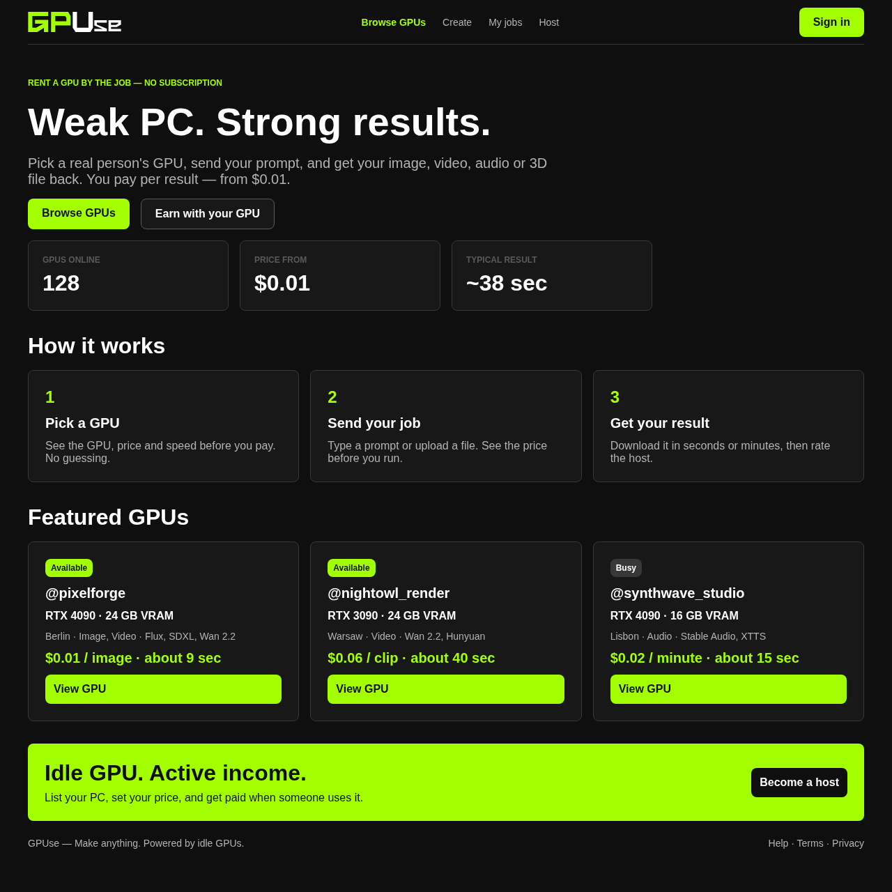
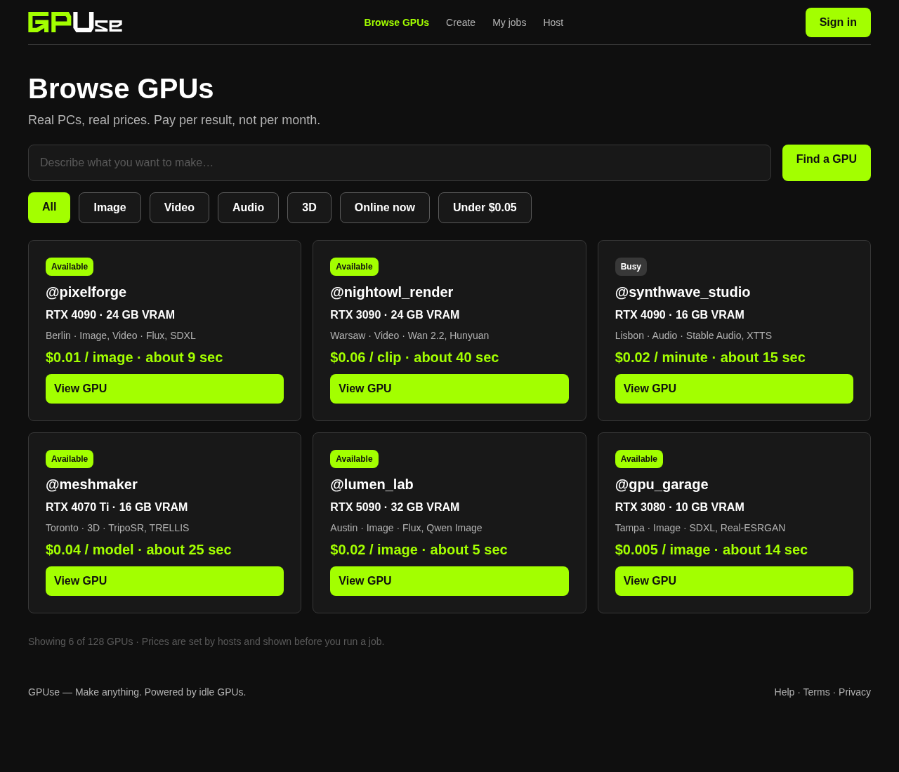
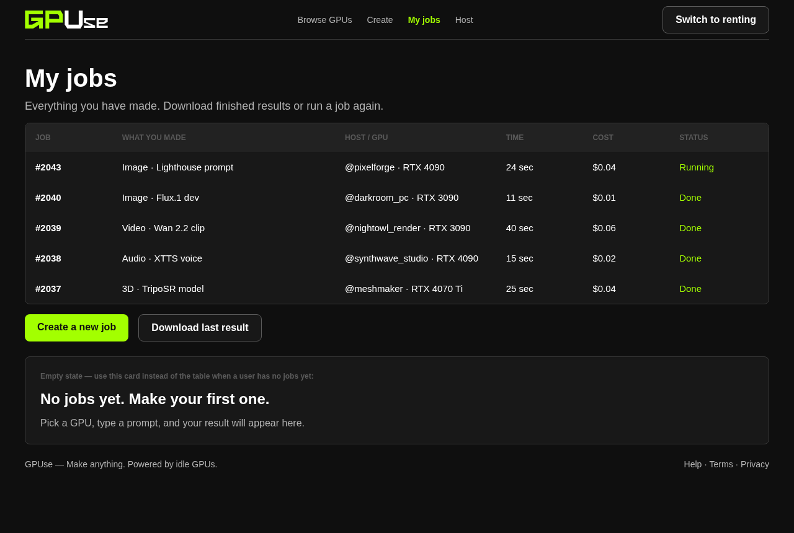
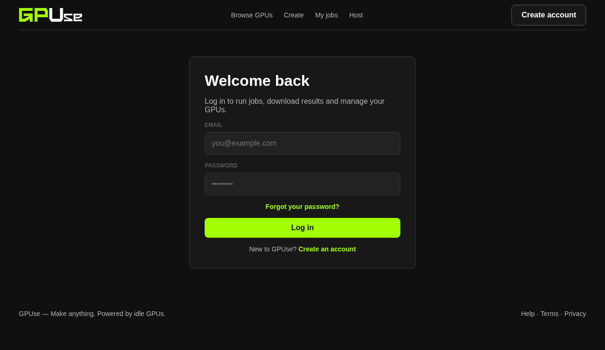
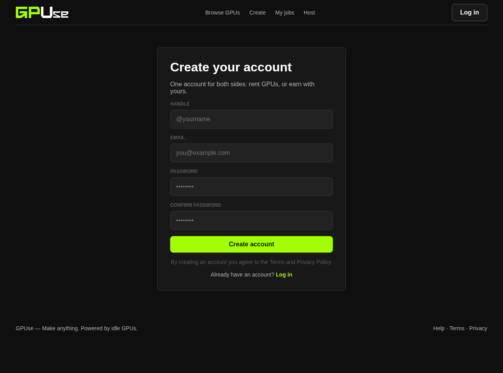

# gpuse

<picture>
  <source media="(prefers-color-scheme: dark)" srcset="assets/logo.svg">
  <source media="(prefers-color-scheme: light)" srcset="assets/logo-light.svg">
  
</picture>

A distributed GPU compute network that turns idle computing resources into shared processing power. Connect machines, distribute workloads, and execute GPU tasks across a decentralized network.


## What is GPUse?

GPUse is a peer-to-peer GPU marketplace — think "Airbnb for compute":

- **Renters** pick a real person's GPU, send a prompt, and pay **per result** (from $0.01) instead of renting cloud GPUs by the hour.
- **Hosts** share their idle gaming PC, set their own prices, and get paid when someone runs a job on their machine.

## This branch (`aleks`)

This is one of four team branches. It contains the **Landing**, **Browse GPUs**, **My Jobs** and **login/signup** parts of the frontend, plus the screenshots folder. The other screens (create a job, host dashboard, list your GPU) live on the other team members' branches and are merged into `main` from there — that's why some nav links (Create / Host) only work once everything is merged.

Everything is plain HTML + CSS. No JavaScript, no framework, no build step.

## Screenshots

**Landing** — [`index.html`](index.html)


| | |
|---|---|
| **Browse GPUs** — [`browse.html`](browse.html) <br> | **My jobs** — [`my-jobs.html`](my-jobs.html) <br> |
| **Log in** — [`login.html`](login.html) <br> | **Sign up** — [`signup.html`](signup.html) <br> |

## Run it locally

No install needed. Either open `index.html` in a browser, or serve the folder:

```bash
git clone -b aleks https://github.com/alekslime/gpuse.git
cd gpuse
python3 -m http.server 8000
# → http://localhost:8000
```

## Pages on this branch

| File | Screen | What it shows |
|---|---|---|
| `index.html` | Landing | Hero, live stats, how it works, featured GPUs, host banner |
| `browse.html` | Browse GPUs | Search, filters, GPU listing cards with price & speed |
| `my-jobs.html` | My jobs | Job history table + empty state |
| `login.html` | Log in | Email + password login |
| `signup.html` | Sign up | Handle, email, password + confirm password |

## Project structure

```
gpuse/
├── index.html          # Landing
├── browse.html         # Browse GPUs
├── my-jobs.html        # My jobs
├── login.html          # Log in
├── signup.html         # Sign up
├── assets/             # Logo from Figma (logo.svg, logo-light.svg for light backgrounds)
├── css/
│   ├── base.css        # Reset, layout, nav, buttons, footer (all pages)
│   ├── components.css  # Shared pieces: panels, fields, cards, tables
│   ├── browse.css      # One small file per page…
│   ├── landing.css
│   ├── my-jobs.css
│   ├── auth.css        # Log in + sign up
│   └── responsive.css  # Narrow-screen stacking (loaded last)
└── screenshots/        # The images used in this README
```

Every page loads 4 stylesheets in order: `base.css` → `components.css` → its own page file → `responsive.css`.

## Design tokens

Taken 1:1 from the Figma design (page *"GPUse — Easy Build (HTML/CSS/JS)"*):

| Token | Value | Used for |
|---|---|---|
| Background | `#0F0F0F` | Page background |
| Panel | `#181818` | Cards, panels |
| Field | `#222222` | Inputs, table header |
| Border | `#383838` | Card and panel borders |
| Accent | `#A3FF00` | Buttons, prices, highlights |
| Text grey | `#B3B3B3` | Secondary text |
| Text dim | `#5A5A5A` | Labels, footnotes |

Font: **Inter** (Google Fonts, Arial fallback). Corner radius is 8px everywhere. Layout is a centered 1200px column; on narrow screens the grids simply stack.

## Status

Static frontend prototype. All data (GPUs, prices, jobs) is sample content written directly in the HTML, and interactive elements are visual only until a backend is connected.

## License

[MIT](LICENSE)
