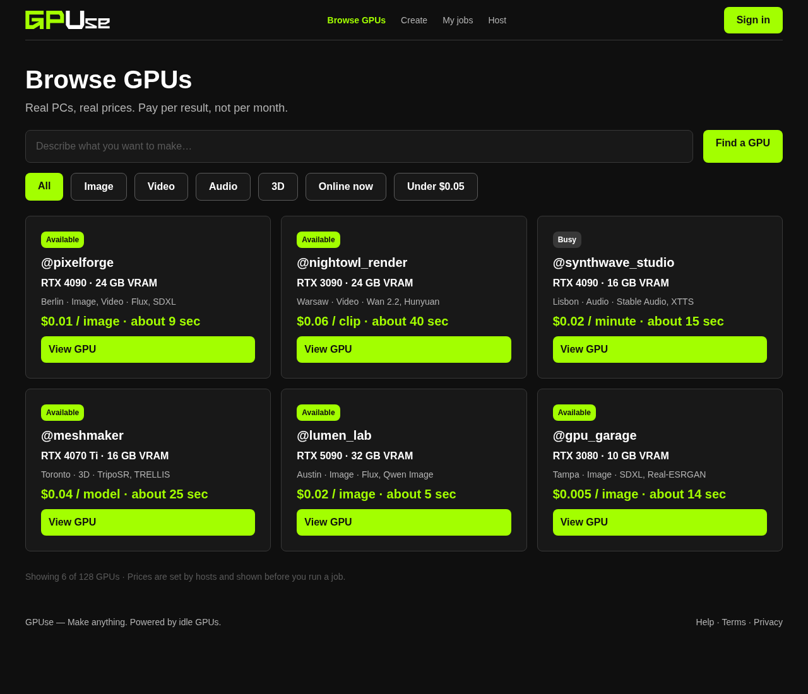
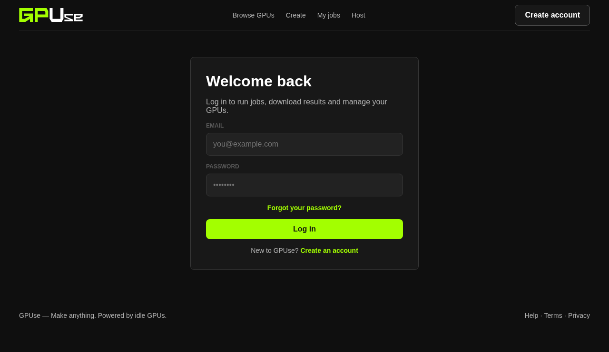
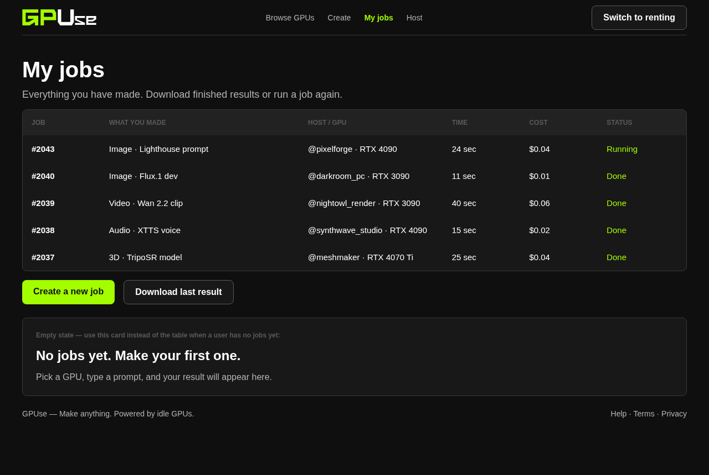
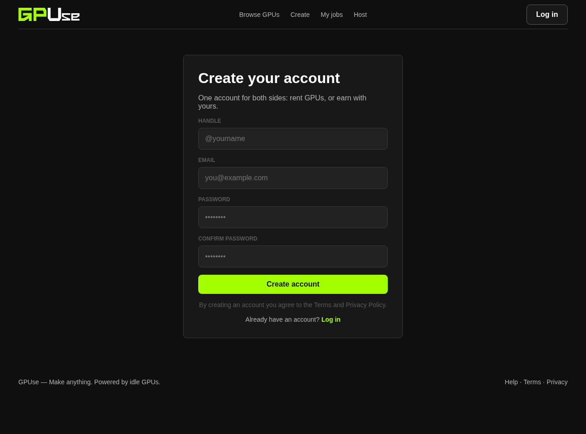

# GPUse

<picture>
  <source media="(prefers-color-scheme: light)" srcset="assets/logo-light.svg">
  
</picture>

Airbnb for compute. People with idle gaming GPUs share them, creators rent them to generate AI images, video, audio, and 3D. Pay per result, not per month.

Hosts earn passive income from PCs that would sit idle. Renters get cheap on-demand generation without cloud prices or subscriptions.

## Screens

### Browse GPUs

### Log in

### My jobs

### Sign up

